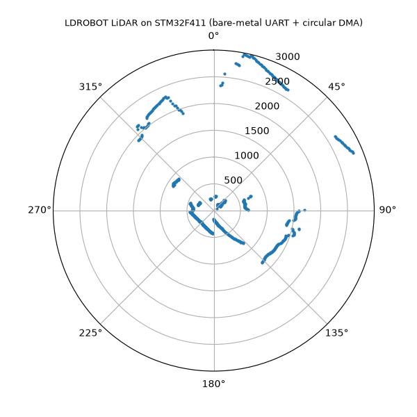
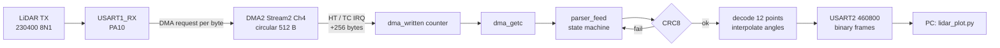

# stm32-lidar-driver

A bare-metal UART + DMA receive driver for an LDROBOT 2D LiDAR (STL-19P / D500, LD06/LD19 family) on an STM32F411RE. There's no HAL and no RTOS: the clock tree, USART, DMA and NVIC are configured register by register from the reference manual. Packets are framed by a byte-at-a-time state machine, checked with CRC8, decoded into 12 points each, and streamed to a PC for a live polar plot.

The project was built in measured steps. Each stage was stress-tested on hardware before moving on, and the numbers below come from the board, not from datasheets.



## Headline result

Same sensor, same load, two receive designs. The load is the CPU blocked with interrupts disabled (or a priority-0 SysTick busy-waiting):

| Load | Interrupt RX, pkt/s | Circular DMA RX, pkt/s |
|---|---|---|
| baseline | 416 | 416 |
| IRQs off 200 µs every 20 ms | 329 | **416** |
| IRQs off 200 µs every 10 ms | 248 | **417** |
| IRQs off 200 µs every 5 ms | 79 | **416** |
| IRQs off 200 µs every 2 ms | **1** | **417** |
| IRQs off 30 µs every 2 ms | 416 | 416 |
| SysTick (prio 0) 100 µs every 1 ms | **1** | **417** |
| SysTick (prio 0) 30 µs every 1 ms | 415 | 416 |

DMA mode had zero CRC failures and zero buffer laps in every row.

**Why:** the USART holds exactly one received byte in `DR`. At 230400 baud (8N1), the next byte completes 43.4 µs later. Any blackout longer than one byte time causes a hardware overrun, and no software buffer can help, because the byte is lost before code ever sees it. DMA empties `DR` without the CPU, so the limit moves from **43.4 µs** to **13.1 ms**, the time to fill half of the 512-byte circular buffer.

The interrupt-driven version is in history at commit `6e1cc44`.

## Hardware

| Part | Notes |
|---|---|
| NUCLEO-F411RE | STM32F411RE, Cortex-M4F, run at 100 MHz from PLL |
| LDROBOT STL-19P (D500) | 230400 8N1, 47-byte packets, 12 points each, ~10 rev/s |
| ST-LINK V2-1 (on board) | Flashing + virtual COM port, 8 MHz clock into HSE bypass |

| Signal | Pin | Function |
|---|---|---|
| LiDAR TX | PA10 (Arduino D2) | USART1_RX, AF7, pull-up |
| LiDAR VCC | 5V | Motor supply |
| LiDAR GND | GND | |
| LiDAR PWM | not connected | Default speed |
| PC link | PA2 | USART2_TX, AF7 → ST-LINK VCP |
| Clock check | PA8 | MCO1 = PLL / 5 = 20 MHz |
| LED | PA5 | LD2 |

## Data path



- **ISR:** reads `LISR` once, clears HT/TC in `LIFCR` (write-1-to-clear), and adds 256 to `dma_written`. That's the whole job: 29 cycles on average.
- **Main:** owns `parsed`. `dma_written - parsed` is the number of pending bytes (unsigned, so it stays correct across wrap). If DMA got more than 512 bytes ahead, that's a lap: it's counted and `parsed` skips forward.
- **One writer per variable:** the ISR writes `dma_written` and main writes `parsed`. This is why there are no locks.
- **Memory ordering:** `rx_buf` is not `volatile`, so a `__DMB()` sits between reading `dma_written` and reading the buffer. Results are identical at `-O0` and `-O2`.

## Parser

Packets are framed one byte per call, so parsing can stop and resume at any byte:

```
WAIT_54 --54--> WAIT_2C --2C--> COLLECT --47 bytes--> CRC8
              <--other--   |--54: stay (possible real start)
```

**Resync:** when CRC fails, bytes 1..46 of the bad packet are fed back into the parser. A real header hidden inside the bad packet is found instead of swallowed. Measured with one byte dropped per DMA burst (~76 drops/s):

| | without resync | with resync |
|---|---|---|
| pkt/s | 267 | 339 |
| packets lost per dropped byte | ~2 | ~1 |
| crc failures/s | 72 | 72 |

The CRC failure rate is the same in both cases. The second lost packet never shows up as a CRC failure; it simply never arrives. Only throughput reveals it.

**Angles:** start/end angles are interpolated across the 12 points in integer 0.01° units, with 0° wraparound (`end < start` → `end += 36000`). The code multiplies before dividing, so there is one truncation per point and the error doesn't accumulate.

## Measurements (baseline, 10 s, `-O2`)

Timed with the DWT cycle counter (10 ns resolution); no logic analyzer was used.

| Metric | Result |
|---|---|
| DMA ISR execution time | min 28, max 39, avg 29 cycles (290 ns) |
| ISR rate | 76 /s (HT + TC) |
| Throughput | 414–416 packets/s (5000 points/s ÷ 12) |
| CRC failures, laps, DMA errors, restarts | 0 |
| Buffer high-water | 256 / 512 bytes |
| CPU time in ISR | 0.002 % |
| Interrupts vs. per-byte IRQ design | 76 /s vs. 19,552 /s (257× fewer) |

**Measured, not assumed:** the plan was built on 375 packets/s (LD19 datasheet, 4500 points/s). The board measured 416/s, because this unit is an STL-19P at 5000 points/s. All buffer and timing numbers were recalculated from the measured rate.

**Buffer sizing:** 416 pkt/s × 47 B = 19,552 B/s, which is 85% of the line's 23,040 B/s capacity. Each 256-byte half fills in 13.1 ms, so main has 13.1 ms to drain a half, about 302× the 43.4 µs that interrupt-per-byte mode allows.

## Robustness

- Every hardware wait (`HSERDY`, `PLLRDY`, `SWS`, DMA `EN`) is bounded. On a timeout the error is counted and boot continues.
- If HSE is missing, the clock falls back to HSI (16 / 8 × 100 / 2 = still 100 MHz). Boot prints which source is in use.
- On a DMA transfer error the stream disables itself, and `dma_restart()` re-arms it.
- After 1 s with no bytes from the sensor, a `no data from sensor` line is printed. When data returns, reception recovers without a reset.
- `HardFault_Handler` resets the MCU, and boot reports that the last reset came from software.

**Known limits:**
- A critical section longer than 13.1 ms would let HT or TC fire twice before the ISR runs. The second event would be lost and `dma_written` would undercount silently. Computing the write position from `NDTR` would fix that.
- There is no hardware watchdog (IWDG) yet.
- USART2 TX is blocking: 1.13 ms per 52-byte frame, about 47% of main's time. That fits easily inside the 13.1 ms window; TX DMA would free that time.

## Why no RTOS

There is one data source, one rate and one consumer. The ISR advances a counter, main parses, and each shared variable has a single writer, so nothing needs a lock or a scheduler. An RTOS would add tick interrupts and context-switch overhead and buy nothing here.

## Portability note

The F411 has no data cache, so the CPU and DMA always see the same RAM. On an STM32F7/H7, `rx_buf` would need cache maintenance (invalidate before reading) or a non-cacheable MPU region.

## Build and flash

Requires `arm-none-eabi-gcc` and OpenOCD. CMSIS headers, the startup file and the linker script are in the repo.

```
arm-none-eabi-gcc -mcpu=cortex-m4 -mthumb -mfloat-abi=hard -mfpu=fpv4-sp-d16 -DSTM32F411xE -O2 -Wall -Wextra -IDrivers/CMSIS/Include -IDrivers/CMSIS/Device/ST/STM32F4xx/Include -T STM32F411RETX_FLASH.ld --specs=nano.specs --specs=nosys.specs Core/Src/main.c Core/Startup/startup_stm32f411retx.s -o lidar.elf

openocd -f board/st_nucleo_f4.cfg -c "program lidar.elf verify reset exit"
```

The linker warnings `_close / _fstat / _isatty / _lseek / _read is not implemented` come from `nosys.specs` and are expected; only `_write` is used, and it is implemented.

Build switches at the top of `main.c`:

| Switch | Effect |
|---|---|
| `PLOT_STREAM 1` | USART2 at 460800, one binary frame per valid packet (for the plot) |
| `PLOT_STREAM 0` | USART2 at 115200, text statistics only |
| `DROP_TEST 1` | Drops one received byte per DMA burst, to exercise resync |

The starvation sweep rows in `tests[]` are commented out; uncomment them to rerun the table above.

## Live plot

```
pip install pyserial numpy matplotlib pillow PyQt6
python lidar_plot.py COM3
python lidar_plot.py COM3 --gif lidar.gif --seconds 8
```

On Windows, use `py` in place of `python` if another Python is first on `PATH`. Close any serial monitor first, because only one program can hold the COM port.

Frame format (52 bytes, little-endian): `AA 55 | 0C | 12 × (angle u16 in 0.01°, distance u16 in mm) | XOR of bytes 2..50`. The script resyncs on `AA 55`, drops frames with a bad XOR, and ignores interleaved text.
